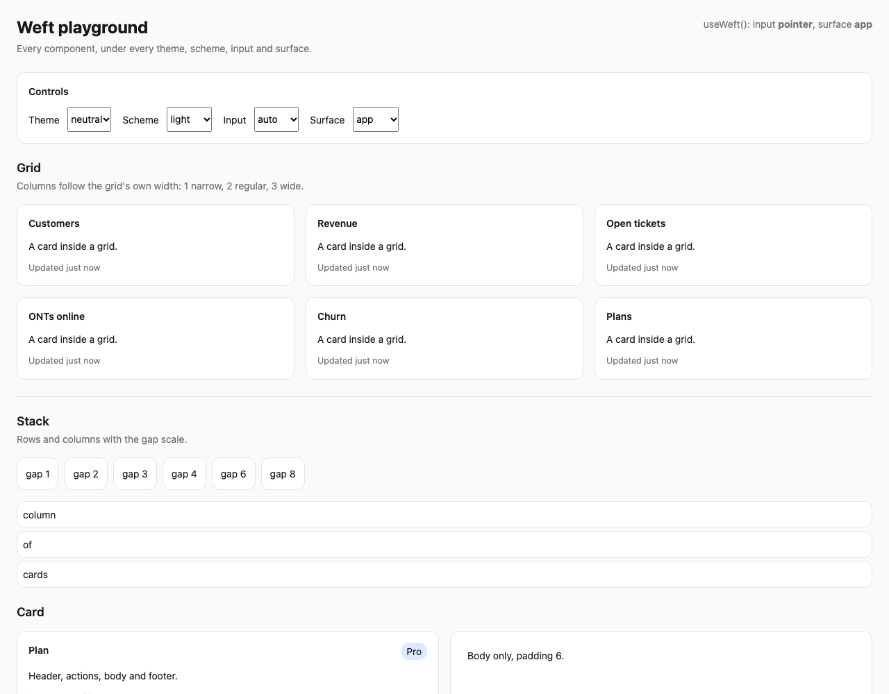
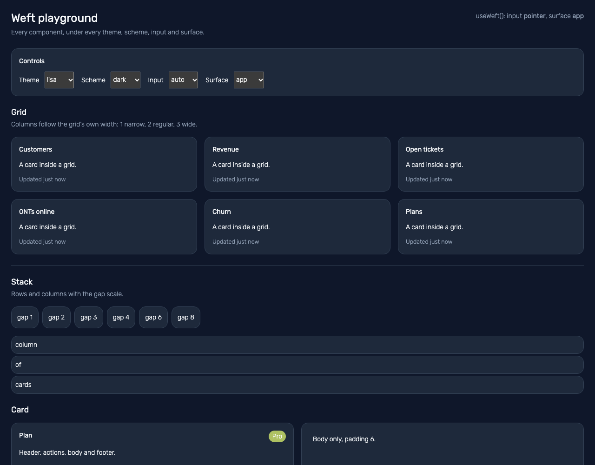

<h1 align="center">weft</h1>

<p align="center">
  <strong>One UI system for Go and Vue apps.</strong><br>
  Vapor-first components that know whether they're under a finger or a mouse,<br>
  on a landing page or in an app — shipped inside a single Go binary.
</p>

<p align="center">
  <code>pre-alpha</code> · <code>Vue 3.6 Vapor</code> · <code>Go 1.26</code> · <code>MIT</code>
</p>

---

```sh
curl -fsSL https://weft.base.al/install | sh
```

## Why

Every product rebuilds the same pieces: a stat card, a table with actions and
paging, an edit dialog, a confirm prompt, a sidebar. Each app drifts a little,
and every agent that builds a screen hand-assembles it from divs again.

Weft is the set of pieces, built once:

- **Yours, all the way down.** Every component, API and style is Weft's. No
  styled kit underneath, no third-party names in your app code.
- **Adaptive by default.** You write `<DatePicker v-model="day" />` once. On a
  mouse it is a popover calendar; under a finger it is a sheet with big targets.
  No `MobileDatePicker` to remember. (The primitives land next; the layout
  components adapt today.)
- **Go-first.** One binary serves your API and embeds your Vue app. No Node in
  production.
- **Built for agents.** Big building blocks, one way to do each thing, and a
  machine-readable catalogue so an agent composes screens instead of guessing.
- **Vapor-first.** Components compile with Vue's Vapor mode: no virtual DOM.

## A taste

```go
//go:embed all:web/dist
var web embed.FS

func main() {
	dist, _ := fs.Sub(web, "web/dist")
	api := http.NewServeMux()
	api.HandleFunc("GET /api/stats", stats)
	http.ListenAndServe(":8080", weft.Serve(dist, api))
}
```

```vue
<script setup vapor lang="ts">
import { Card, Grid, Page } from '@weft/ui'
const stats = [{ name: 'ONTs online', value: 1284 }, { name: 'Open tickets', value: 7 }]
</script>

<template>
  <Page title="Network" description="Live from every ONT.">
    <Grid>
      <Card v-for="s in stats" :key="s.name">
        <template #header>{{ s.name }}</template>
        {{ s.value }}
      </Card>
    </Grid>
  </Page>
</template>
```

`weft.Serve` sends `/api/*` to your handlers, serves hashed assets with a
year-long cache, and answers every other path with `index.html` so the router
can take it.

## How it adapts

Two independent axes, read by every component through `useWeft()`:

| | **pointer** (mouse, trackpad) | **touch** (finger) |
|---|---|---|
| **app** | dense: 36 px controls, 14 px text, popovers | 44 px targets, sheets instead of popovers |
| **landing** | roomy: 18 px text, capped page width | roomy and touch-sized |

Input comes from what the browser reports (`(pointer: coarse)`), never from a
device name, and follows changes live. Surface is declared by the layout:
`<WeftProvider surface="landing">`. Width comes from each component's own
container, so a grid in a side panel lays out narrow on a big screen.

<p align="center">
  
  
</p>

## Themes

A theme is one token file: colours for light and dark, radius, spacing, type,
motion. Weft ships `neutral` and `lisa` (generated from LisaOS's token
contract). Components read only `--weft-*` custom properties, so a brand is a
stylesheet, not a fork. Want Tailwind for your own components? Import
`@weft/themes/tailwind.css` and its colours are Weft's.

## Status

Pre-alpha. What exists today:

- `weft` CLI (`version`) and the curl installer
- tokens and the `neutral` and `lisa` themes
- the adaptive core: `useWeft`, `WeftProvider`, `useWidth`
- layout: `Stack`, `Grid`, `Page`, `Section`, `Card`, `Divider`
- `weft.Serve` for embedded frontends, and a playground that uses all of it

Next, in order: the headless layer and primitives (buttons, inputs, select,
date picker, upload, dialog…), the Go-to-Vue contract (types and validation
generated from Go structs, `weft add crud`), login and permissions,
`weft create` / `dev` / `build`, app blocks and live charts, the agent kit
(catalogue, skills, lint, MCP), and landing blocks. The full design is in
[`docs/superpowers/specs/2026-11-20-weft-design.md`](docs/superpowers/specs/2026-11-20-weft-design.md).

## Develop

Needs Go 1.26, Node 22.6+ and pnpm 10.

```sh
pnpm install
scripts/playground.sh        # build the web app, run the Go binary on :8080
pnpm test && go test ./...   # the Go tests need the playground build first
```

## License

MIT. The `lisa` theme's values come from LisaOS; the Lisa name and brand are
not granted by this licence.
